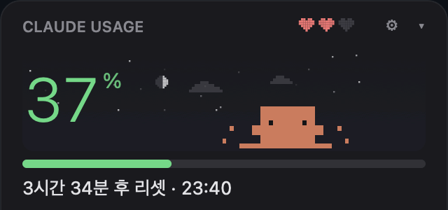
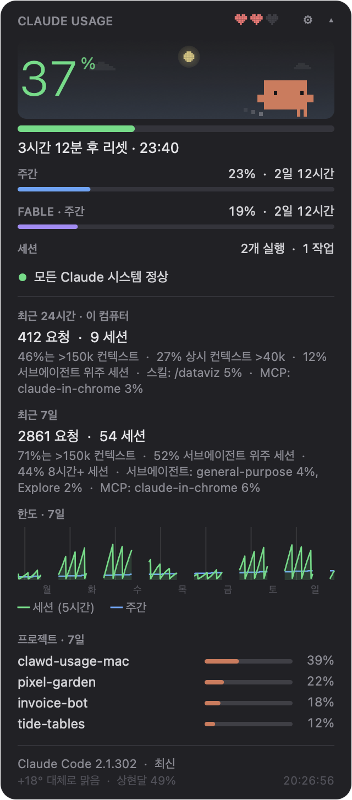
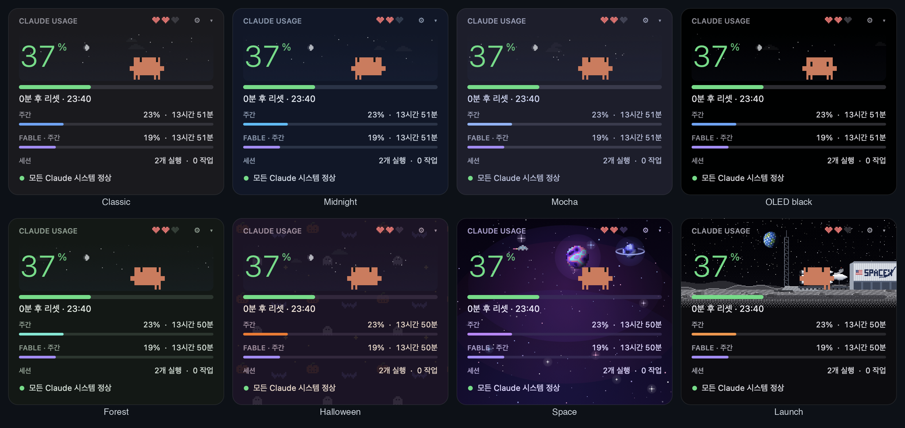
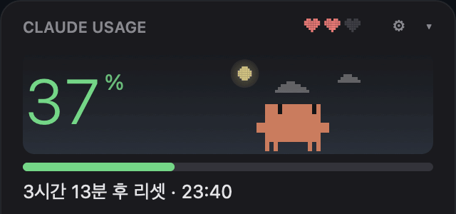
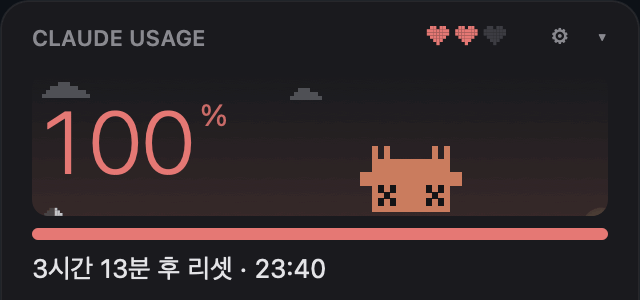
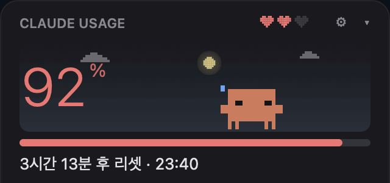
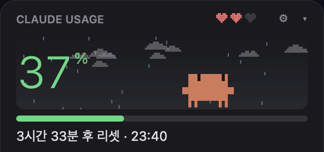
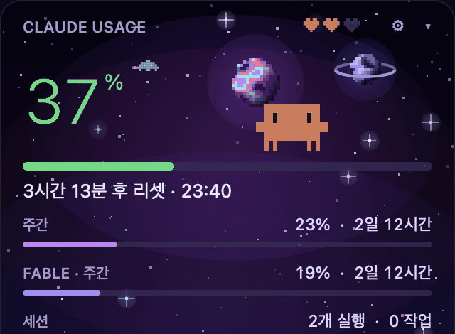
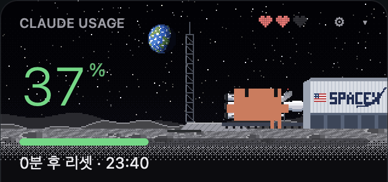
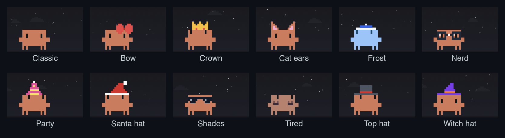

# clawd-usage-mac

Claude 요금제 한도를 얼마나 썼는지 보여 주는 macOS 메뉴바 앱입니다. Claude Code의 `/usage`와 같은 숫자를 1분마다 갱신합니다. 메뉴바의 게를 누르면 위젯이 펼쳐지고, 그 안에 사는 픽셀 Clawd가 Claude Code 세션 상태에 따라 반응합니다.

[@Enhed](https://github.com/Enhed)의 [clawd-usage-winwidget](https://github.com/Enhed/clawd-usage-winwidget)을 macOS로 옮긴 버전입니다.

[English](README.md) · **한국어**



- **공식 숫자만 씁니다.** 퍼센트는 `claude -p /usage`에서 가져옵니다. 이 슬래시 명령은 기존 로그인으로 Anthropic 서버에 묻기만 하고, **모델을 호출하지 않아 토큰을 쓰지 않습니다**.
- **의존성이 없습니다.** 작은 Swift/AppKit 네이티브 앱 하나입니다(Apple Silicon·Intel 겸용). Electron, Node, 설치 프로그램 없음.

화면은 한국어와 영어를 지원하고, 시스템 언어를 따릅니다. 메뉴 → 언어에서 바꿀 수도 있습니다.
- **Clawd.** Claude Code 시작 화면의 그 게를 같은 블록 글리프와 같은 애니메이션으로 그렸습니다. 아무것도 안 돌면 모래 속에서 자고, 세션이 일하면 뛰어다니고, 세션이 입력을 기다리면 `?`를 띄우고 깡충거립니다. 한도가 가까우면 땀을 흘리고, 다 쓰면 배를 드러내고 눕습니다.

| 상세 보기: 한도, 세션, `/usage` 통계, 7일 그래프, 프로젝트 | 테마 |
|---|---|
|  |  |

## 설치

필요한 것: macOS 13 이상, Claude 계정으로 로그인한 [Claude Code](https://docs.claude.com/en/docs/claude-code).

### 내려받기

1. [Releases](https://github.com/fl03er/clawd-usage-mac/releases/latest)에서 `ClawdUsage-<버전>.zip`을 내려받아 압축을 풉니다.
2. `ClawdUsage.app`을 `응용 프로그램`(또는 `~/Applications`)으로 옮깁니다.
3. Apple 공증(유료 개발자 계정 필요)을 받지 않은 앱이라 처음 열 때 "Apple이 확인할 수 없습니다"라며 막힙니다. **시스템 설정 → 개인정보 보호 및 보안**에서 ClawdUsage 옆의 **그래도 열기**를 누르거나, 터미널에서 한 번 실행하세요.

   ```bash
   xattr -dr com.apple.quarantine /Applications/ClawdUsage.app
   ```

### 소스에서 빌드

Xcode Command Line Tools(`xcode-select --install`)가 필요합니다.

```bash
git clone https://github.com/fl03er/clawd-usage-mac.git
cd clawd-usage-mac
./build.sh install
open ~/Applications/ClawdUsage.app
```

`./build.sh`는 스크립트 옆에 `ClawdUsage.app`을 만들고, `install`을 붙이면 `~/Applications`에도 복사합니다.

**처음 한 번 로그인하세요.** 위젯은 Claude Code CLI로 한도를 읽는데, CLI 로그인은 Claude 데스크톱 앱 로그인과 따로입니다.

```bash
claude auth login
```

Claude 계정(구독)을 고르고 브라우저에서 승인하면 1분 안에 숫자가 뜹니다.

**로그인 시 자동 실행:** 메뉴바 게를 우클릭하고 *로그인 시 자동 실행*을 누르세요. macOS가 시스템 설정 → 일반 → 로그인 항목에서 허용을 요청할 수 있습니다.

## 무엇을 보여 주나

**메뉴바**: 위젯과 똑같이 움직이는 Clawd(스킨 적용)와 세션 퍼센트, 리셋 시각. 왼쪽 클릭은 위젯 펼치기, 오른쪽 클릭은 메뉴입니다.

**큰 숫자**: 현재 세션(5시간 창) 사용량을 서버에서 그대로 가져옵니다. 바는 초록 → 노랑(60%) → 빨강(85%)으로 바뀝니다. 아래에 리셋까지 남은 시간이 나옵니다.

**주간**, **Fable · 주간**: 주간 한도와 리셋까지 남은 시간. Fable 줄은 `/usage`가 알려 줄 때만 보입니다.

**세션**: 실행 중인 Claude Code 세션 수와 그중 작업 중이거나 입력을 기다리는 수. Claude Code가 직접 관리하는 목록(`~/.claude/sessions`)을 읽고, 살아 있는 프로세스만 셉니다. 메뉴에 목록이 나옵니다: ▶ 작업 중, ? 대기, ○ 쉬는 중.

**서비스 상태**: status.claude.com 기준으로 정상이면 초록, 장애가 있으면 노랑이나 빨강과 함께 장애 내용을 보여 줍니다.

헤더의 **▾**를 누르면 상세 보기가 펼쳐집니다(다음 실행에도 기억):

- **최근 24시간 / 최근 7일**: 요청 수, 세션 수, `/usage`의 "무엇이 한도를 쓰고 있나" 분석. Claude Code도 근사치라고 밝히며, 이 컴퓨터 사용분만 셉니다.
- **한도 · 7일**: 지난 일주일 동안의 5시간(초록)·주간(파랑) 퍼센트. 마우스를 올리면 그 시각, 두 퍼센트, 그 시간에 가장 많이 쓴 프로젝트가 나옵니다. `/usage` 응답이 올 때마다 기록하므로 첫 실행부터 쌓입니다.
- **프로젝트 · 7일**: 이번 주 가장 많이 쓴 프로젝트. 이 컴퓨터의 Claude Code 기록에서 토큰을 모델 가격으로 가중해 셉니다. 공식 수치가 아닌 추정치입니다.
- **하단**: Claude Code 버전(업데이트 여부), 날씨와 달 위상, 마지막 `/usage` 응답 시각.

**한도 알림**: 세션이나 주간 한도가 80%, 95%를 넘거나 다 쓰면 macOS 알림을 보냅니다(창마다 한 번). 많이 쓰다가 5시간 창이 리셋될 때도 알려 줍니다. 메뉴에서 끌 수 있습니다.

## Clawd

| | |
|---|---|
|  |  |
| 클릭하면 Claude Code 애니메이션 중 하나와 하트 | 세션 한도를 다 쓰면 뒤집혀 눕고, 클릭하면 영혼이 빠져나옴 |
|  |  |
| 5시간 창이 리셋되면 축하와 색종이 | 하늘은 실제 시간대와 날씨를 따름 |

| 상황 | Clawd |
|---|---|
| Claude Code가 안 돌고 있음 | 모래 속에 파묻혀 자고, "z"가 떠오름 |
| 세션이 쉬는 중 | 돌아다니고, 두리번거리고, 커서를 따라 보고, 휘파람을 붊. 가끔 손을 흔들거나 기지개 |
| 위젯 위에 10분간 마우스가 없음 | 선 채로 졸다가 가끔 화들짝 |
| 세션이 작업 중 | 집중한 눈으로 양 끝을 뛰어다니며 먼지를 날림 |
| 세션이 입력을 기다림 | 눈을 크게 뜨고 깡충거리며 손짓, 노란 `?` |
| 세션이 방금 끝남 | 웅크렸다가 두 팔을 번쩍 |
| 클릭 | Claude Code 애니메이션 중 하나(점프, 회전, 까꿍, 윙크, 부프, 재채기, 동전 점프…)와 하트 |
| 5시간 창이 리셋됨 | 두 번 점프, 초록 `!`, 색종이 |
| 세션 85% 이상 | 땀을 흘리며 눈을 굴림 |
| 세션 100% | X 눈으로 뒤집혀 누움. 클릭하면 영혼이 실에 매달려 빠져나감 |

헤더의 하트 세 개는 다마고치처럼 Clawd의 체력, 곧 남은 세션 한도입니다. 하트 반 칸이 약 16.7%이고, 하트가 0이 되는 건 100%일 때뿐입니다. 기운이 넘치면 빨리 걷고 깡충거리고, 지치면 하품하며 느려지고, 거의 바닥이면 비틀거리고 땀을 흘리고 가끔 넘어집니다.

## 하늘

큰 숫자 뒤에 옅은 하늘이 있습니다. 현재 위치의 실제 일출·일몰을 따라 해가 호를 그리며 지나가고, 밤에는 실제 위상의 달과 반짝이는 별이 뜹니다. 날씨에 따라 바람에 흘러가는 구름, 이슬비, 비, 소나기, 눈(Clawd 발밑에 쌓임), 안개, 뇌우가 나옵니다.

날씨는 [Open-Meteo](https://open-meteo.com)(키 필요 없음)에서 가져오고, 위치는 실행할 때마다 한 번 [ipwho.is](https://ipwho.is)로 IP 기반 조회합니다. 메뉴에서 *하늘과 날씨*를 끄면 아무 요청도 보내지 않습니다.

## 테마와 스킨

**테마**(메뉴 → 테마): 클래식, 미드나이트, 모카, OLED 블랙, 포레스트, 작은 호박·박쥐·유령 배경이 깔리는 할로윈, 그리고 **우주**: 위젯 전체에 보라색 별하늘이 깔리고, 별이 반짝이고, 성운이 흐르고, 픽셀 행성 두 개가 천천히 자전하며 떠다닙니다. 가끔 별똥별과 작은 우주선도 지나갑니다.



**발사**: 검은 하늘에 지구가 떠 있는 달 표면의 발사장이 30초마다 한 바퀴 돕니다. 3코어 로켓이 수송차에 누운 채 기지에서 나와 발사대에 세워지고, 증기를 뿜다가 점화해 위젯 위로 사라집니다. 분사에 날린 월면 먼지는 낮게 포물선을 그리며 흩어졌다가 다음 로켓이 나오기 전에 가라앉습니다. 1포인트 픽셀과 오더드 디더링으로 그렸습니다.



 *계절 따라*를 고르면 9~11월엔 할로윈, 나머지는 클래식입니다.

**Clawd 스킨**(메뉴 → Clawd 스킨): Clawd의 색과 함께 움직이는 픽셀 액세서리입니다. 모자는 머리가 화면 안에 있을 때만 보이고, 뒤집혀 누우면 벗겨집니다.



직접 만들기: 메뉴 → Clawd 스킨 → *내 스킨 폴더 열기*에 `.txt`를 넣고 앱을 다시 실행하세요. 형식은 원본과 같습니다.

```
---
name: Top hat
body: #D77757
eyes: #141416
k: #4B5563
r: #DC2626
---
......kkkkkkk.....
......kkkkkkk.....
......kkkkkkk.....
......rrrrrrr.....
...kkkkkkkkkkkkk..
```

`body`와 `eyes`는 선택입니다. 한 글자 키는 아래 그림에서 그 글자의 색이고, `.`은 빈칸입니다. 그림은 Clawd와 같은 18픽셀 너비이고 머리 바로 위에 놓입니다. `top: 1`처럼 쓰면 첫 줄 위치를 Clawd의 맨 윗줄 기준으로 옮길 수 있습니다.

## 데이터 출처

| 무엇 | 출처 | 주기 |
|---|---|---|
| 한도와 통계 | `claude -p /usage --output-format text --no-session-persistence` | 60초마다, 위젯을 열 때 |
| 세션 | `~/.claude/sessions/<pid>.json` (Claude Code가 직접 관리) | 2초마다 |
| 프로젝트 | `~/.claude/projects/**/*.jsonl` (파일마다 새로 추가된 부분만 읽음) | 15분마다 |
| 최신 버전 | `downloads.claude.ai/claude-code-releases/latest` (또는 `stable`) | 1시간마다 |
| 서비스 상태 | `status.claude.com/api/v2/summary.json` | 5분마다 |
| 날씨 | Open-Meteo, 위치는 ipwho.is | 30분마다 |

설정은 `UserDefaults`(`local.clawd-usage-mac`)에, 7일 기록은 `~/Library/Application Support/ClawdUsage/usage-history.json`에 저장됩니다.

## 구조

```
Sources/
  main.swift    앱: 메뉴바 아이템, 펼침 패널, 데이터 갱신, 메뉴, 알림
  Widget.swift  위젯 화면: 레이아웃, Clawd 기분과 애니메이션, 그래프
  Sprite.swift  Clawd 글리프, 자세, Claude Code 애니메이션 시퀀스
  Sky.swift     하늘, 해, 달 위상, 구름, 비, 눈, 안개, 번개
  Look.swift    테마와 스킨
  Space.swift   우주 테마의 별하늘, 행성, 우주선
  Launch.swift  발사 테마의 달 기지와 로켓 발사 사이클
  Lang.swift    한국어 / 영어
  Data.swift    /usage 파싱, 세션, 기록, 프로젝트 집계, 네트워크
  Demo.swift    README 이미지용 데모 모드와 프레임 녹화
skins/          기본 스킨
tools/          record.sh + make_gif.py: 데모 데이터로 docs/ 이미지 생성
```

`tools/record.sh`는 가짜 숫자로 앱을 데모 모드로 실행하고, 화면을 프레임 단위로 녹화해 위 GIF들을 영어(`docs/`)와 한국어(`docs/ko/`)로 만듭니다(Pillow가 설치된 Python 필요). `./build.sh release`는 겸용 빌드 zip을 `dist/`에 만듭니다.

## 만든 사람들

Clawd에 관한 모든 것(Claude Code 블록 글리프로 만든 스프라이트, 애니메이션, 기분, 하트, 스킨, 하늘)과 `/usage` 파싱 규칙은 Venger Sergey의 [clawd-usage-winwidget](https://github.com/Enhed/clawd-usage-winwidget)과 그 [포팅 가이드](https://github.com/Enhed/clawd-usage-winwidget/blob/main/docs/PORTING.md)에서 왔습니다. MIT 라이선스, [LICENSE](LICENSE) 참고.

Anthropic과 관계없는 개인 프로젝트입니다. Clawd와 Claude는 Anthropic의 것입니다.
