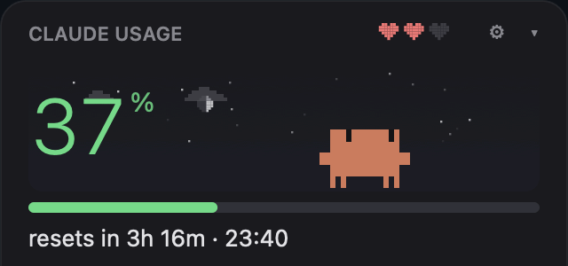
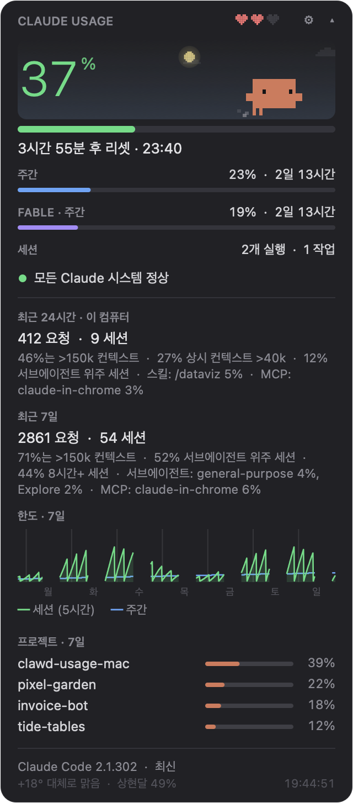
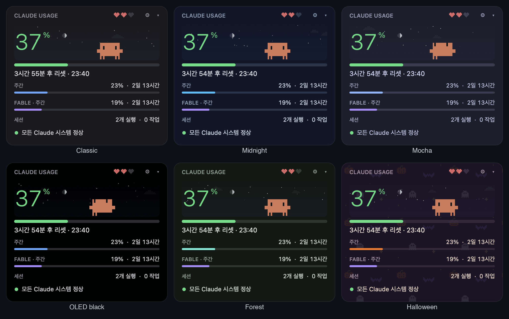
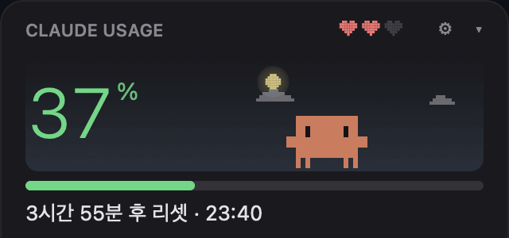
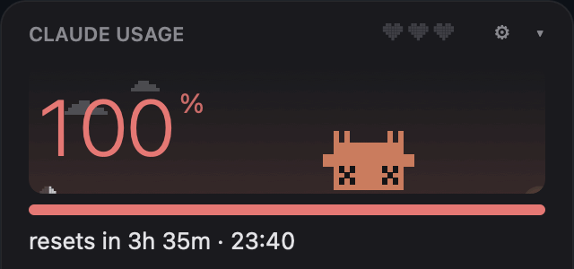
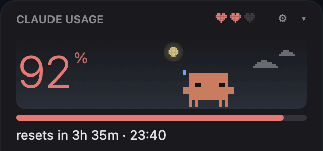
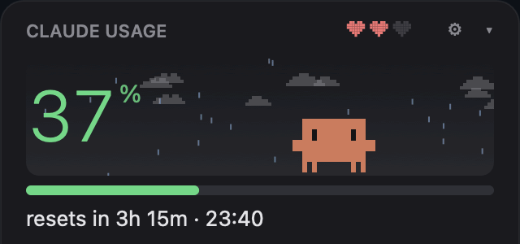
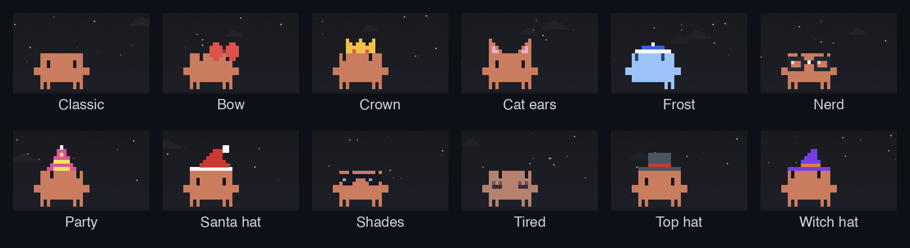

# clawd-usage-mac

A menu bar app for macOS that shows how much of your Claude plan limits you've used: the same numbers as `/usage` in Claude Code, refreshed every minute. Click the crab in the menu bar and the widget drops down, with a pixel Clawd who lives in it and reacts to what your Claude Code sessions are doing.

A macOS port of [clawd-usage-winwidget](https://github.com/Enhed/clawd-usage-winwidget) by [@Enhed](https://github.com/Enhed).

**English** · [한국어](README.ko.md)



- **Official numbers only.** Percentages come from `claude -p /usage`. The slash command runs headless, talks to Anthropic with your existing login and **does not call the model or spend tokens**.
- **No dependencies.** One native Swift/AppKit app, built with the Swift compiler that ships with the Xcode Command Line Tools. No Electron, no Node, no installer.
- **Clawd.** The crab from Claude Code's welcome screen, built from the same block glyphs and with the same animations. He sleeps when nothing runs, runs around while a session works, hops with a `?` when a session is waiting for you, sweats near the limit and lies belly-up when it's used up.

> The interface is in Korean for now. The numbers and Clawd speak every language.

| Details: limits, sessions, `/usage` stats, the 7-day chart and top projects | Themes |
|---|---|
|  |  |

## Install

Requirements: macOS 13 or later, the Xcode Command Line Tools (`xcode-select --install`) and [Claude Code](https://docs.claude.com/en/docs/claude-code) installed and logged in with your Claude account.

```bash
git clone https://github.com/fl03er/clawd-usage-mac.git
cd clawd-usage-mac
./build.sh install
open ~/Applications/ClawdUsage.app
```

`./build.sh` builds `ClawdUsage.app` next to the script; `install` also copies it to `~/Applications`.

**Log in once.** The widget reads limits through the Claude Code CLI, whose login is separate from the Claude desktop app:

```bash
claude auth login
```

Pick your Claude account (subscription), approve in the browser, and the numbers show up within a minute.

**Start at login:** right-click the crab in the menu bar → *로그인 시 자동 실행* (start at login). macOS may ask you to allow it in System Settings → General → Login Items.

## What it shows

**Menu bar**: Clawd, animated like in the widget and wearing his skin, plus the session percentage and its reset time. Left-click drops the widget down, right-click opens the menu.

**Big number**: the current session (the 5-hour window), straight from the server. The bar goes green → yellow (60%) → red (85%). Under it, the time until the window resets.

**Weekly** and **Fable · weekly**: the weekly limits and time to reset; the Fable row is hidden if `/usage` doesn't report it.

**Sessions**: how many Claude Code sessions are running and how many are working or waiting for you, read from Claude Code's own registry (`~/.claude/sessions`). Only live processes count. The menu lists them: ▶ working, ? waiting, ○ idle.

**Service status**: green "all systems operational", or yellow/red with the active incident, from status.claude.com.

**▾ in the header** expands the details (remembered between runs):

- **Last 24 hours / last 7 days**: requests, sessions and the "What's contributing to your limits usage?" breakdown from `/usage`. Claude Code calls it approximate and counts only this computer.
- **Limits · 7 days**: the 5-hour (green) and weekly (blue) percentages over the last week. Hover for the moment under the cursor: the time, both percentages and the project that spent the most in that hour. Every `/usage` answer is a sample, so the chart fills in from the first run.
- **Projects · 7 days**: the projects that spent the most this week, counted from Claude Code's transcripts on this computer: tokens weighted by the model's price, an estimate rather than an official figure.
- **Footer**: your Claude Code version (and whether an update is out), the weather and the moon phase, the time of the last `/usage` answer.

**Limit alerts**: a macOS notification when the session or the week crosses 80% and 95% or runs out (once per window), and when the 5-hour window resets after a busy stretch. Turn it off in the menu.

## Clawd

| | |
|---|---|
|  |  |
| Click him: a random Claude Code animation and a heart | Session limit used up: belly-up; click and his soul floats out |
|  |  |
| The 5-hour window resets: celebration and confetti | The sky follows the real time of day and live weather |

| situation | Clawd |
|---|---|
| Claude Code isn't running | burrows into the sand and sleeps, "z"s float up |
| sessions are idle | wanders, looks around, follows your cursor, whistles; sometimes waves or stretches |
| 10 minutes with no mouse over the widget | dozes standing up, sometimes startles |
| a session is working | runs edge to edge with a focused squint, dust flying |
| a session is waiting for you | wide eyes, hops and waves, yellow `?` above |
| a session just finished | crouches and throws his arms up |
| you click him | a random Claude Code animation (jump, spin, peekaboo, wink, boop, sneeze, coin hop…) and a heart |
| the 5-hour window resets | celebrates: two jumps, green `!`, confetti |
| session above 85% | sweats and darts his eyes |
| session at 100% | lies belly-up with X eyes; click him and his soul floats out on a string |

The three hearts in the header are his health, tamagotchi-style: how much of the session limit is left. Each half heart is about 16.7%; zero hearts only at 100%. Full of energy he walks faster and hops; tired he yawns and slows down; barely alive he staggers, sweats and sometimes trips.

## Sky

Behind the big number there's a faint sky. It follows real sunrise and sunset for your location: the sun moves along an arc, at night there's the moon in its actual phase and twinkling stars. Weather adds clouds drifting with the wind, drizzle, rain, showers, snow (that settles under Clawd's feet), fog and thunderstorms.

Weather comes from [Open-Meteo](https://open-meteo.com) (no key); the location is looked up once per run by IP via [ipwho.is](https://ipwho.is). Turn it off with *하늘과 날씨* (sky and weather) in the menu and no request is made.

## Themes and skins

**Themes** (menu → 테마): Classic, Midnight, Mocha, OLED black, Forest and Halloween, with a wallpaper of tiny pumpkins, bats and ghosts. *By season* is Halloween in September–November and Classic the rest of the year.

**Clawd's skins** (menu → Clawd 스킨): his colours plus pixel accessories that move with him. A hat shows while his head is in the frame, and lying on his back he loses it.



Your own skin: menu → Clawd 스킨 → *내 스킨 폴더 열기* (open my skins folder), put a `.txt` there and restart. The format is the same as the original's:

```
---
name: Top hat
body: #D77757
eyes: #141416
k: #4B5563
r: #DC2626
---
......kkkkkkk.....
......kkkkkkk.....
......kkkkkkk.....
......rrrrrrr.....
...kkkkkkkkkkkkk..
```

`body` and `eyes` are optional. Every one-letter key is a colour for that letter in the art below; `.` is empty. The art is 18 pixels wide, as Clawd, and sits right on his head; `top: 1` puts its first row elsewhere, counted from his top row.

## Where the data comes from

| what | source | how often |
|---|---|---|
| limits and stats | `claude -p /usage --output-format text --no-session-persistence` | every 60 s, and when the widget opens |
| sessions | `~/.claude/sessions/<pid>.json`, kept by Claude Code itself | every 2 s |
| projects | `~/.claude/projects/**/*.jsonl` (only the new part of each file is read) | every 15 min |
| latest version | `downloads.claude.ai/claude-code-releases/latest` (or `stable`) | hourly |
| status | `status.claude.com/api/v2/summary.json` | every 5 min |
| weather | Open-Meteo, location via ipwho.is | every 30 min |

Settings live in `UserDefaults` (`local.clawd-usage-mac`), the 7-day history in `~/Library/Application Support/ClawdUsage/usage-history.json`.

## How it's built

```
Sources/
  main.swift    app delegate: menu bar item, dropdown panel, polling, menu, alerts
  Widget.swift  the widget view: layout, Clawd's moods and animations, chart
  Sprite.swift  Clawd's glyphs, poses and the Claude Code animation sequences
  Sky.swift     sky, sun, moon phase, clouds, rain, snow, fog, lightning
  Look.swift    themes and skins
  Data.swift    /usage parsing, sessions, history, project scan, network
  Demo.swift    demo mode and frame recorder for the README images
skins/          built-in skins
tools/          record.sh + make_gif.py: render docs/ from demo data
```

`tools/record.sh` runs the app in demo mode with fake numbers, records frames straight from the view and turns them into the GIFs above (needs Python with Pillow).

## Credits

Everything about Clawd (the sprite built from Claude Code's block glyphs, the animations, moods, hearts, skins, the sky) and the `/usage` parsing rules come from [clawd-usage-winwidget](https://github.com/Enhed/clawd-usage-winwidget) by Venger Sergey and its [porting guide](https://github.com/Enhed/clawd-usage-winwidget/blob/main/docs/PORTING.md). MIT License, see [LICENSE](LICENSE).

Not affiliated with Anthropic. Clawd and Claude are Anthropic's.
